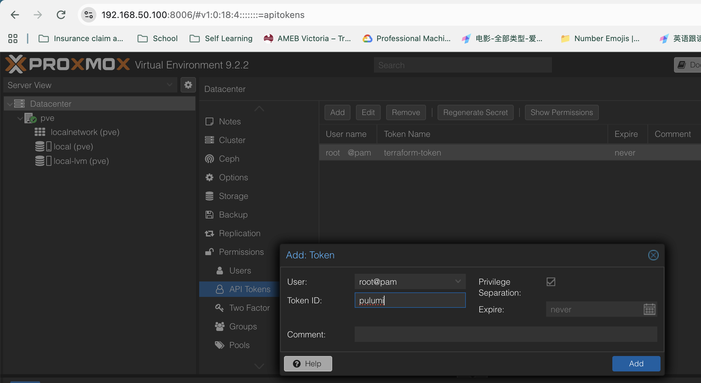

## Layout
```javascript
/** 
* packages - code that builds resources 
* configs - YAML that describes an environment 
*/

infrax/
|- Pulumi.yaml       /* program entry, like the engine root */
|- package.json
|- tsconfig.json
|- .gitignore
|- packages/
|  |- proxmox/       /* constructs, like packages/opentofu */
|     |- src/
|        |- index.ts              /* provider + exports */
|        |- ubuntu-template.ts    /* VM template resource */
|- configs/
   |- environments/
      |- dev.yaml                 /* sizes, datastore, image, VM id */
```

## create pulumi API Token to proxmox


## Set up in a minute
```bash
node -v
pulumi version

npm install --registry https://registry.npmjs.org

pulumi login --local  # keeps state local
pulumi stack init dev

pulumi config set --secret proxmoxApiToken 'root@pam!pulumi=b8f0e192-bd88-4381-861d-59411ed5aa8b'
pulumi config set ssbPublicKeyPath ~/.ssh/id_ed25519.pub
pulumi config set sshPrivatekeyPath ~/.ssh/id_ed25519

pulumi preview # see the plan
pulumi up --stack dev      # confirm with yes
pulumi destroy --stack dev

# run npm install --registry https://registry.npmjs.org for new changes
npm install --registry https://registry.npmjs.org
```
## Encapsulate Tailscale to the template

Template is created with template: true and never starts, so nothing inside the disk image can join Tailscale. Every clone inherits the user-data sinnpet and runs it on first boot, which gives each nodes its own Tailscale identity. 
